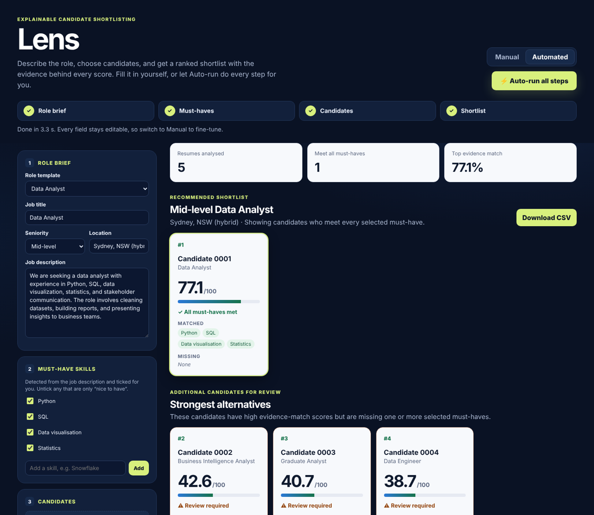
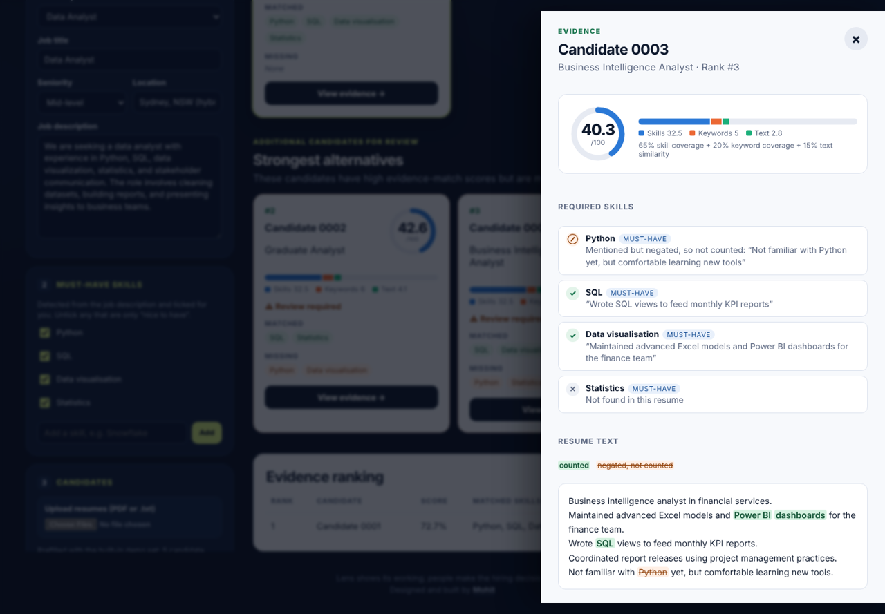
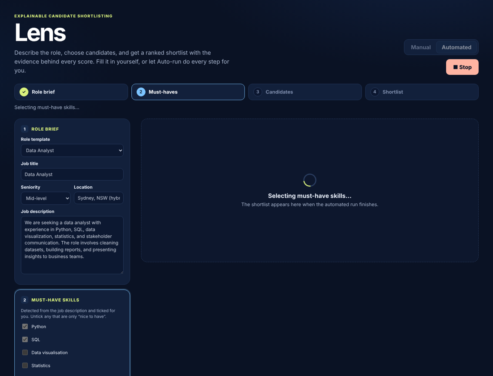
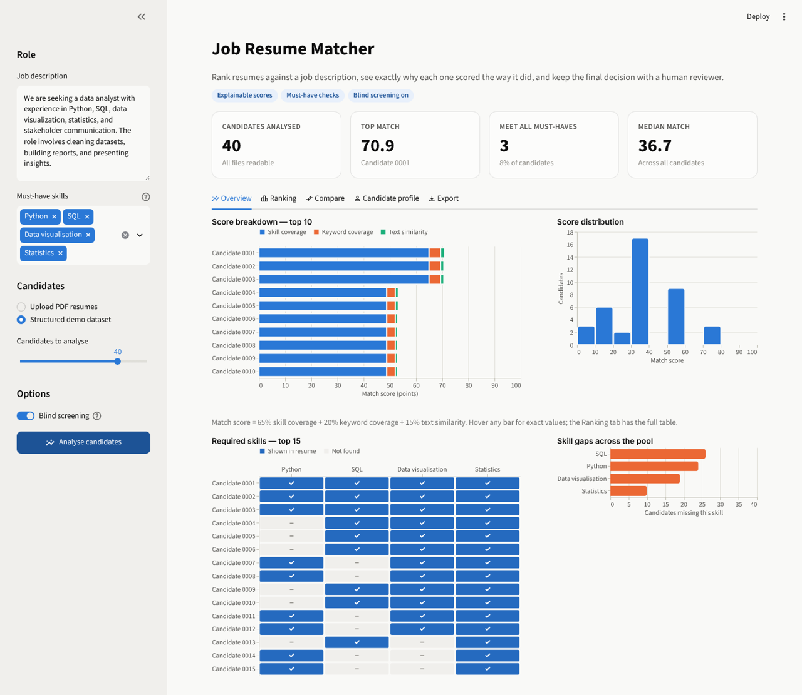

# Lens

**See who fits — and exactly why.**

Lens ranks a stack of resumes against a job description and traces every score back
to the skills it found, so a recruiter can see the evidence behind each shortlist
and the final call stays with a person.

**Live demo:** coming soon



## How it works

1. **Describe the role.** Pick a ready-made role, or choose **Write my own role** and
   just paste your own job description: Lens fills the job title, seniority, minimum
   experience, employment type and location from it. Required
   skills and the minimum years of experience ("3+ years") are detected automatically.
2. **Choose must-haves.** Untick any skill that is only "nice to have".
3. **Add candidates.** Upload resumes, or use the built-in demo set.
4. **Review the shortlist.** Every candidate shows a score ring out of 100, a bar
   showing how many points came from skills, keywords and text similarity, and
   whether all must-haves are met.
5. **See what stands out.** Awards, competition results (HackerRank, Kaggle,
   hackathons), certifications and internships are pulled out of each resume and shown
   on the card, so a recruiter can understand the candidate beyond the score.
6. **Check the evidence.** "View evidence" opens the resume with every counted skill
   highlighted, the exact sentence behind each match, and negated mentions such as
   "no Python experience" struck through so you can see what was *not* counted.



Prefer one click? In the web app, **Auto-run all steps** fills the form and builds
the shortlist for you, showing each step as it goes. With your own role brief it keeps
your text exactly as written.



## Two ways to use it

| | Web app (`vercel-app/`) | Python dashboard (`app/`) |
|---|---|---|
| Built with | Next.js + TypeScript | Streamlit + scikit-learn |
| Resumes | PDF or `.txt`, read in the browser | PDF files |
| Highlights | Evidence panel, score rings, Manual and Automated modes, role templates, runs fully in the browser | Charts, candidate comparison, PDF decision report, structured demo dataset |



## Features

- **Explainable scores**: every candidate shows matched and missing skills and how
  many points each score component added.
- **Must-have checks**: required skills are detected from the job description;
  missing must-haves are flagged for review, never auto-rejected.
- **Blind screening** (on by default): names and file names are hidden in results
  and exports.
- **Negation-aware skill detection**: "no Python experience" does not count as Python.
- **Dashboard results** (Streamlit): KPI cards, score-breakdown chart, score
  distribution, required-skills matrix, skill gaps and side-by-side comparison.
- **Privacy-sanitised demo dataset** for trying the app without real uploads.

## FAQ

**Does Lens make hiring decisions?**
No. It ranks and explains; a person decides. Candidates missing a must-have are
flagged for review rather than rejected.

**Where does resume data go?**
The web app runs entirely in your browser, so uploaded text is never sent to a
server. The Streamlit app processes uploads in a temporary folder that is deleted
straight after analysis.

**Does Lens check years of experience?**
Yes, as evidence rather than as a score. It estimates each candidate's experience from
job dates ("Jan 2021 – Present") and statements ("3 years of experience"), ignores
education dates, and compares that with the role's minimum. Candidates below it are
flagged for review, and candidates with unclear experience stay visible, because years
of experience can hint at age and a short career gap should not hide a strong candidate.

**Do awards or "big-name" internships raise the score?**
No. Highlights are shown so the recruiter gets the fuller picture, but they are never
added to the score, and employers are shown exactly as written rather than ranked by
reputation, which would favour candidates with more privileged access.

**Does it use AI or an LLM?**
No. Scoring is transparent: rule-based skill detection plus keyword and TF-IDF
similarity, with fixed weights you can read below. That is what makes every score
explainable.

**How is this different from resume-tailoring tools?**
Those help one candidate tailor one resume to many jobs. Lens works the other way
round: it helps a recruiter screen many candidates for one role.

## Run the web app

```bash
cd vercel-app
npm install
npm run dev
```

Then open http://localhost:3000. See `vercel-app/README.md` for deployment to Vercel.

## Run the Python dashboard

### Setup

#### Windows

```bat
py -3.13 -m venv .venv
.venv\Scripts\activate
python -m pip install --upgrade pip
python -m pip install -r requirements.txt
```

#### macOS and Linux

```bash
python3 -m venv .venv
source .venv/bin/activate
python -m pip install --upgrade pip
python -m pip install -r requirements.txt
```

### Start the dashboard

```bat
.venv\Scripts\streamlit run app\app.py
```

On macOS or Linux, run:

```bash
.venv/bin/streamlit run app/app.py
```

## Optional structured portfolio dataset

To add the privacy-sanitized structured demo data (skills, projects,
certifications, internships, and achievements), run:

```bat
.venv\Scripts\python scripts\import_structured_resumes.py
```

On macOS or Linux:

```bash
.venv/bin/python scripts/import_structured_resumes.py
```

The source is the `hehhe89/resumes` dataset on Hugging Face (`master_resumes.jsonl`).
Check the dataset card for its licence before redistributing anything derived from it.

The importer removes recognised contact, location, employer, date, and other
personal-data fields before saving local data. It also redacts common emails,
phone numbers, and web links from retained text.
When the app is hosted without this ignored local file, it downloads and
sanitizes the same approved dataset for the active session.

## Run the tests

From the project root:

```bash
python -m unittest -v
```

The tests need no network access. One optional test is skipped when the local
`data/archive/` dataset is not present.

## How scoring works

This app supports human review; it does not make automated hiring decisions.

When the job description contains recognised catalogue skills, every candidate
is scored with the same formula:

- 65% skill coverage — recognised job skills found in candidate text.
- 20% keyword coverage — meaningful job-description words also found in the text.
- 15% TF-IDF text similarity — overall similarity between the resume and job description.

When no catalogue skills are found in the job description, the fallback score is
75% keyword coverage and 25% TF-IDF text similarity. The score breakdown is
shown in the app so reviewers can inspect the inputs rather than treating the
ranking as a decision.

## Known limitations

- Literal keyword coverage and TF-IDF similarity can reward keyword stuffing. In
  one probe, a bare keyword list scored 83.8 while a real analyst profile scored
  72.9. A labelled evaluation set is needed before tuning the weights further.
- Skill recognition is a fixed catalogue of roughly 20 skills, not a complete
  understanding of a resume. Related wording outside its patterns can be missed.
- To avoid wrongly hiding real skills, commas and `and` start a new negation
  clause. For example, “No experience with Python, SQL or Tableau” can still
  credit SQL and Tableau.
- Lowercase `excel` without nearby spreadsheet context can be missed.
- Large numbers such as `1200000` can be conservatively redacted as phone-like
  numbers.
- Structured demo data is privacy-reduced, not anonymous: names or employers
  written inside arbitrary free text cannot be removed reliably.
- Scanned or image-only PDFs need OCR before their text can be analysed.
- Experience estimates (web app) are approximate: unusual date formats are missed,
  and a negation after the phrase ("2 years of experience is not something I have")
  is not detected.
- Blind screening hides candidate and file identifiers in results, but resume
  text can still contain protected attributes or other bias-relevant signals.

## Project layout

- `vercel-app/` — Next.js web app with Manual and Automated modes.
- `app/` — Streamlit dashboard (sidebar inputs, KPI cards, tabbed results, charts).
- `.streamlit/config.toml` — app theme and the 10 MB upload limit.
- `src/` — reusable extraction, skill detection, scoring and report code.
- `scripts/` — structured-dataset import and privacy sanitisation.
- `tests/` — unit tests (`python -m unittest`).
- `data/structured/` — privacy-sanitized structured portfolio dataset used by the app.
- `data/` — sample PDF and optional legacy PDF archive retained locally for extraction tests.
- `notebooks/` — exploratory analysis.
- `docs/screenshots/` — images used in this README.
- `CHANGELOG.md` — completed features, fixes, and dependency changes.
